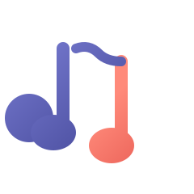
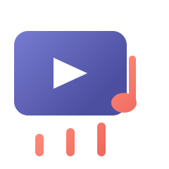
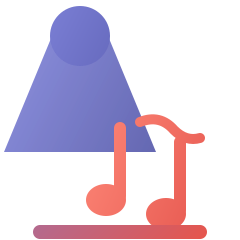

# Propositions de logos LADS — univers spectacle / musique / téléchargement

Toujours en style icône sans fond, avec les dégradés indigo/corail de l'originel, mais cette fois en intégrant l'univers de LADS : karaoké, musique, scène, vidéo, téléchargement.

| # | Fichier | Concept |
|---|----------|---------|
| 1 | [icon-micro.svg](icon-micro.svg) | **Micro + plateforme** — un micro à capsule karaoké qui "atterrit" sur un réceptacle de téléchargement corail. |
| 2 | [icon-notes.svg](icon-notes.svg) | **Notes ♪♪** — deux notes de musique, une indigo (la source) et une corail (le résultat téléchargé). |
| 3 | [icon-scene.svg](icon-scene.svg) | **Écran vidéo + play** — un écran façon YouTube avec triangle blanc, prolongé par une barre de progression corail et une note de musique en sortie. |
| 4 | [icon-projecteur.svg](icon-projecteur.svg) | **Projecteur de scène** — un faisceau de lumière indigo éclaire deux notes de musique corail, sur un socle en dégradé fusion. |

Aperçu rapide :

| 1 | 2 | 3 | 4 |
|---|---|---|---|
|  |  |  |  |

Toutes les propositions restent en dégradé indigo → corail, sans fond, à l'esprit du style icône.

## Concepts et intentions

- **1 · Micro** : la capsule en gradient indigo, inclinée à 45° comme un micro sur pied, avec la plateforme corail en dessous — elle fait à la fois scène et réceptacle de téléchargement.
- **2 · Notes** : la première note indigo (ce qu'on écoute), la seconde corail (ce qu'on télécharge), reliées par une liaison.
- **3 · Écran** : le rectangle arrondi indigo + play blanc évoque instantanément la vidéo/YouTube ; les trois traits corail sous l'écran forment une barre de progression, et la note en bas à droite rappelle que tout ça finit en chanson.
- **4 · Projecteur** : le projecteur indigo envoie son faisceau (la lumière du spectacle) sur deux notes corail (la musique) ; le socle fusionne les deux dégradés.
